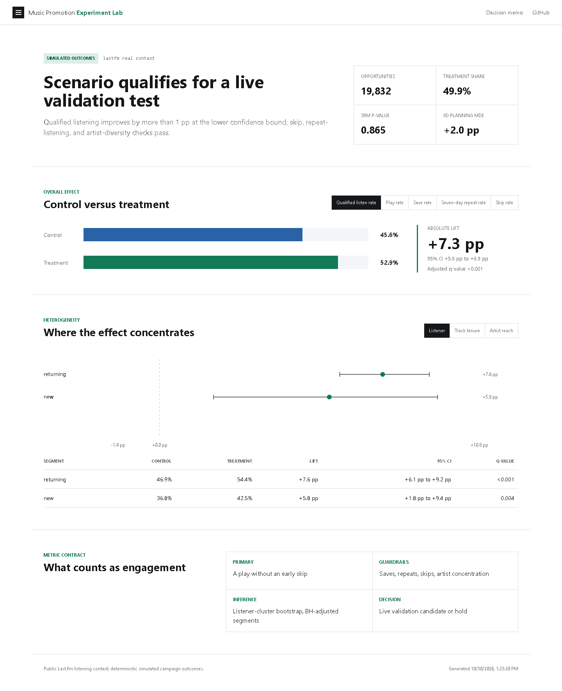
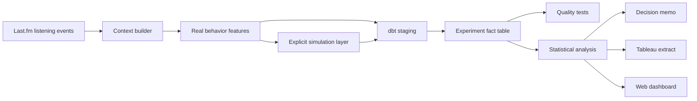

# Music Promotion Experiment Lab

[](https://github.com/nikhildinesharora/music-promotion-experiment-lab/actions/workflows/ci.yml)

A product analytics case study that asks a deliberately harder question than
"did promotion create more plays?":

> Did promotion create qualified listener engagement without degrading skips,
> repeat behavior, or artist diversity?

The repository follows an experiment from raw listening history to a product
decision. It includes a BigQuery-ready dbt warehouse, data contracts, a
reproducible randomized-trial simulation, statistical checks, a packaged Tableau
workbook, and a one-page recommendation memo.

[Interactive dashboard](https://nikhildinesharora.github.io/music-promotion-experiment-lab/)
| [Decision memo](reports/decision_memo.md)
| [Tableau workbook](tableau/Music-Promotion-Experiment-Lab.twbx)

## Read this first: what is real and what is simulated

The listener, artist, track, timestamp, popularity, tenure, and repeat-history
features are derived from the public Last.fm 1K listening-history dataset. The
campaign assignment and post-exposure outcomes are simulated with a fixed seed
because the public data does not contain a randomized promotion experiment.

That distinction is intentional and visible in the data model. The results show
whether the analytics system recovers a known scenario; they do **not** estimate
the effect of a real Spotify, Last.fm, or artist campaign.

## Latest simulated readout

The reproducible real-context run contains **19,832 session opportunities** from
50 listeners. Assignment passed the sample-ratio check (SRM p=0.865).

| Metric | Control | Treatment | Change | 95% CI |
| --- | ---: | ---: | ---: | ---: |
| Qualified listen rate | 45.6% | 52.9% | **+7.3 pp** | +5.8 to +8.9 pp |
| Play rate | 59.5% | 68.7% | **+9.2 pp** | +7.7 to +10.8 pp |
| Save rate | 5.3% | 7.4% | **+2.1 pp** | +1.4 to +2.8 pp |
| Seven-day repeat rate | 8.4% | 10.5% | **+2.1 pp** | +1.2 to +3.0 pp |
| Skip rate among plays | 23.4% | 22.9% | -0.5 pp | -1.8 to +1.0 pp |

**Scenario decision:** the generated experiment qualifies for live validation
under the documented benefit and guardrail criteria. The recommendation is
to validate the instrumentation and decision rule in a live, pre-registered
experiment before changing any product traffic.



## Deliverables

- **Warehouse:** dbt models for BigQuery, with a credential-free DuckDB target
  for local review.
- **Quality:** uniqueness, referential-integrity, accepted-value, range, and
  sample-ratio tests.
- **Experiment:** deterministic assignment, SRM test, confidence intervals,
  80% power/MDE, and Benjamini-Hochberg adjusted segment comparisons.
- **Decision support:** overall and segmented effects for listener relationship,
  observed track tenure, and artist popularity.
- **Communication:** a responsive browser dashboard, an embedded Hyper extract
  and four-sheet Tableau workbook, plus a generated one-page product memo.

## Metric contract

| Metric | Role | Definition |
| --- | --- | --- |
| Qualified listen rate | Primary | Opportunity produced a play that was not skipped early |
| Play rate | Diagnostic | Opportunity produced any play |
| Save rate | Secondary | Listener saved the promoted track |
| Seven-day repeat rate | Guardrail | Listener returned to the same track within seven days |
| Skip rate | Guardrail | Early skips divided by plays |
| Artist HHI | Guardrail | Concentration of played artists; lower is more diverse |

The unit of randomization and analysis is a listening-session opportunity.
Assignment is 50/50 within the deterministic simulation. Confidence intervals
are listener-cluster bootstraps, so repeat activity by the same listener is not
treated as fully independent.

## Architecture



## Reproduce locally

Python 3.11 or newer is required. The source download is about 24 MB and is
licensed for non-commercial use.

```bash
python -m venv .venv
# Windows: .venv\Scripts\activate
# macOS/Linux: source .venv/bin/activate
pip install -r requirements-dev.txt
python scripts/run_pipeline.py
```

The command downloads the source data, builds the experiment, runs `dbt seed`,
`dbt run`, and `dbt test`, executes the statistical analysis, and refreshes the
memo and dashboard assets. Generated outputs are written to `artifacts/`.

Raw source data, row-level seeds, and the opportunity-level Tableau extract are
regenerated locally and excluded from Git. Aggregated, non-identifying results
remain in the repository for review.

For a fast pipeline check that does not download Last.fm data:

```bash
python scripts/run_pipeline.py --demo
```

The demo path is for CI and engineering validation only. Published analysis
should be generated from the real-data path.

## Run on BigQuery

The BigQuery run completed in project `music-promotion-experiment-lab`, dataset
`music_promotion_lab`: two seeds, five models, and all 38 dbt tests passed.
The final report reads the cloud fact table. A DuckDB target supports review
without credentials. See [publishing status](reports/publishing-status.md)
and [warehouse evidence](artifacts/warehouse_validation.json).

```powershell
pip install -r requirements-bigquery.txt
gcloud auth application-default login
$env:GCP_PROJECT_ID = "music-promotion-experiment-lab"
python scripts/run_pipeline.py --target bigquery
```

On macOS/Linux, use `export GCP_PROJECT_ID=music-promotion-experiment-lab`.
The cloud path runs dbt in BigQuery and reads its fact table back for statistical
analysis. Queries have a 1 GB per-query billing cap. This is a cap, not a promise
of zero charges.

## Tableau and browser checks

```bash
pip install -r requirements-tableau.txt
python scripts/build_tableau.py
pip install -r requirements-browser.txt
python scripts/check_dashboard.py
```

The Tableau package includes aggregate data only. Its Hyper extract and workbook
structure are programmatically checked. Visual verification and publishing to
[Nikhil's Tableau Public profile](https://public.tableau.com/app/profile/nikhil.arora1250)
require signing in to Tableau Public. The web dashboard is a separate companion,
not a Tableau embed.

## Review the work

1. Read [`reports/decision_memo.md`](reports/decision_memo.md) for the product
   recommendation and limitations.
2. Open [`docs/index.html`](docs/index.html) for the interactive companion
   dashboard.
3. Inspect [`artifacts/experiment_summary.csv`](artifacts/experiment_summary.csv)
   and [`artifacts/segment_effects.csv`](artifacts/segment_effects.csv) for the
   statistical outputs.
4. Use [`tableau/README.md`](tableau/README.md) to publish the supplied extract
   as a Tableau Public dashboard.

## Why not use a predictive model?

Prediction is not the decision problem here. A model can identify listeners who
are likely to engage, but it cannot establish whether promotion caused that
engagement. This project therefore prioritizes randomization, metric design,
failure checks, uncertainty, and a launch recommendation over model accuracy.

## Limitations

- Last.fm activity is historical and may not represent current streaming users.
- "Track tenure" means time since first observation in this dataset, not an
  official release date.
- The 50-user development subset limits external validity. Listener-cluster
  intervals address dependence but cannot create population coverage.
- Campaign outcomes are simulated and must never be presented as real lift.
- Saves and early skips are absent from Last.fm and exist only in the declared
  simulation layer.

See [`reports/methodology.md`](reports/methodology.md) for assumptions and
[`DATA_LICENSE.md`](DATA_LICENSE.md) for dataset terms.

